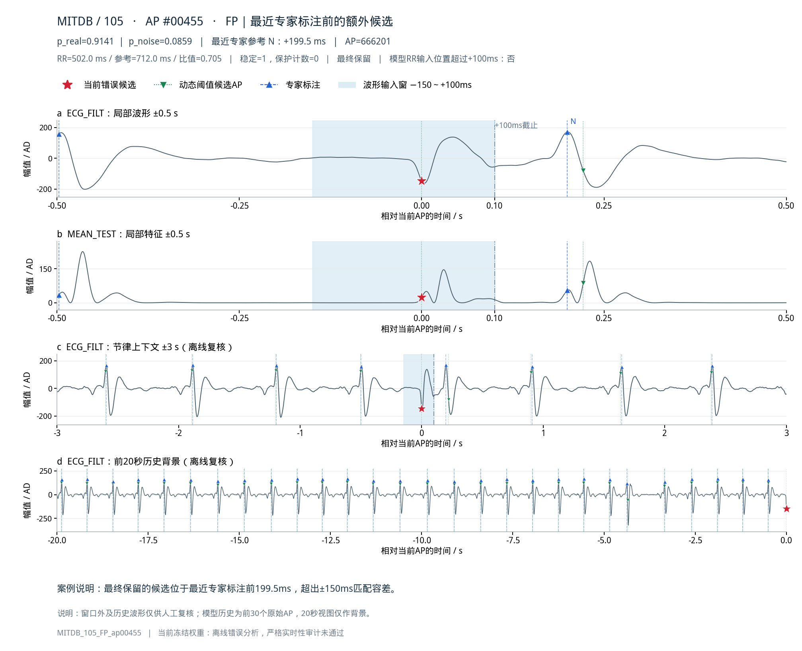
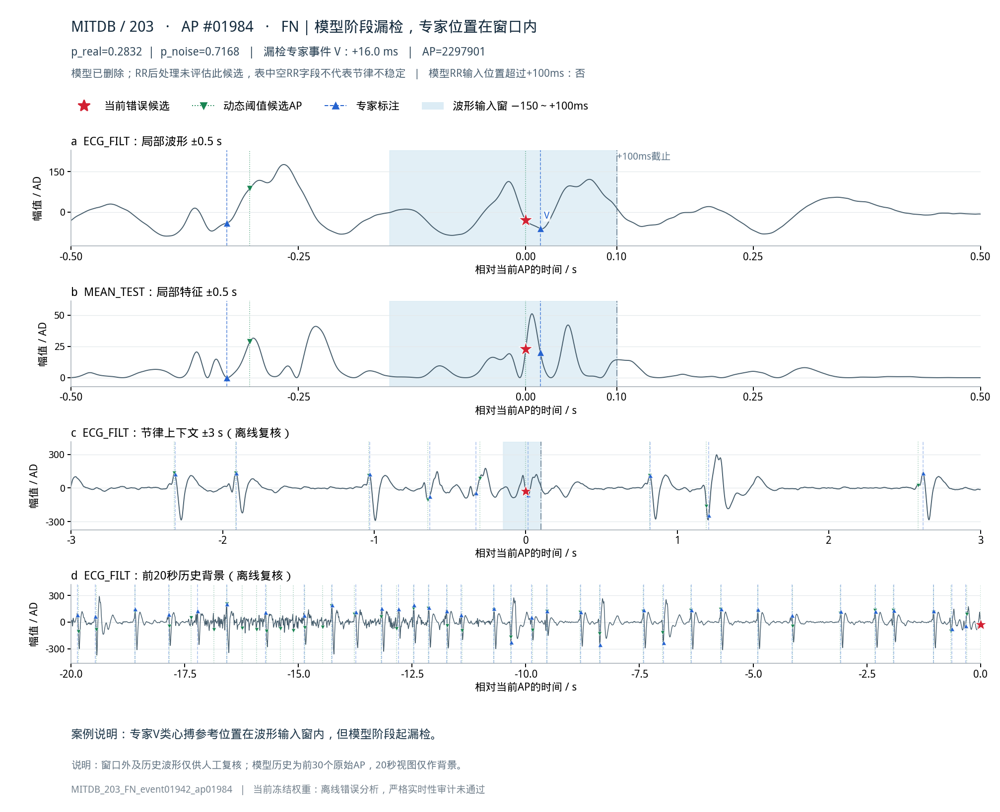
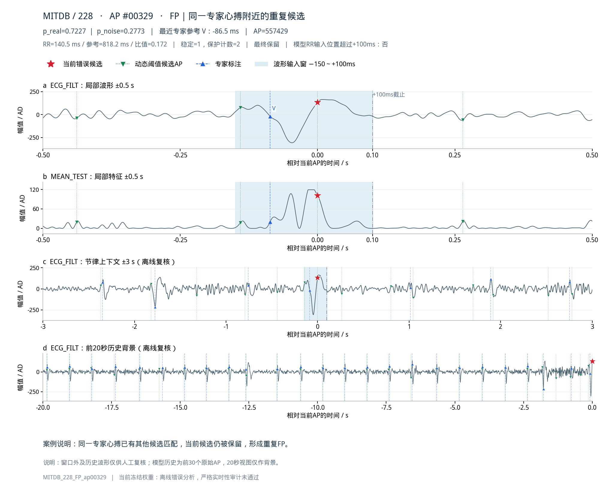
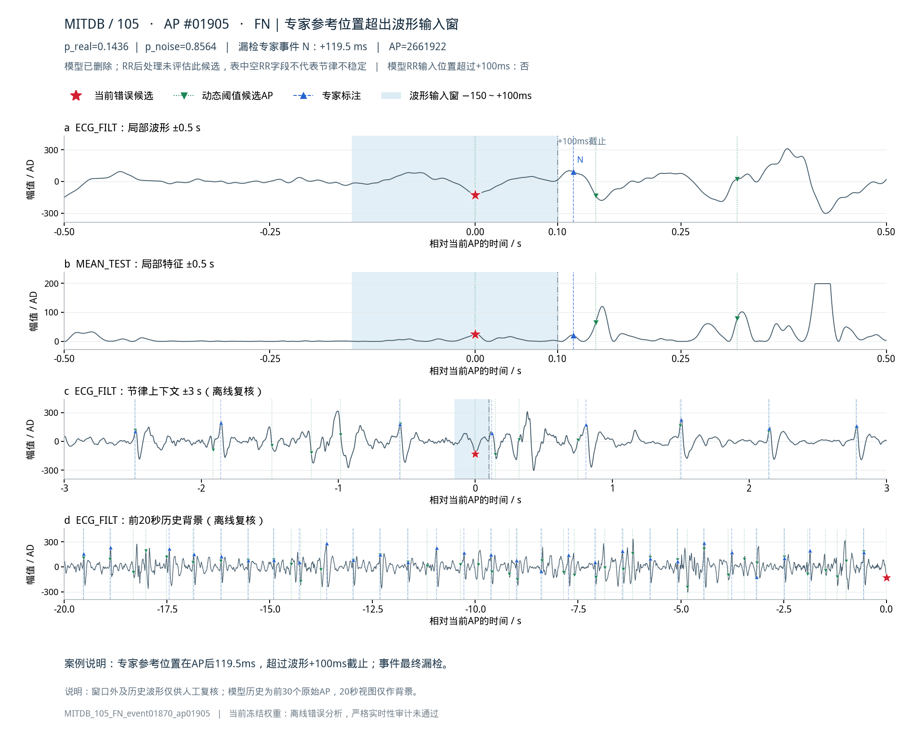
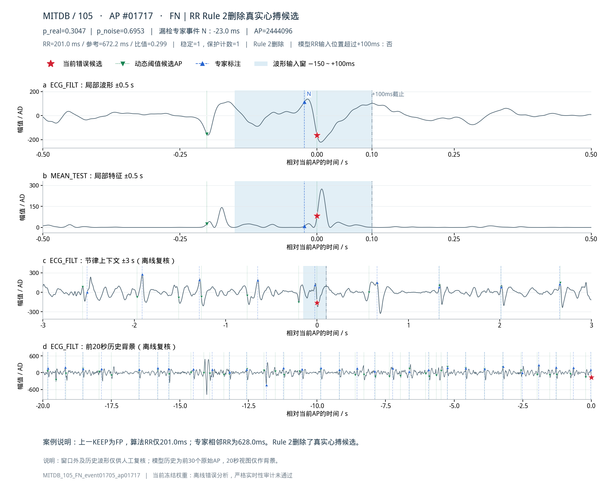
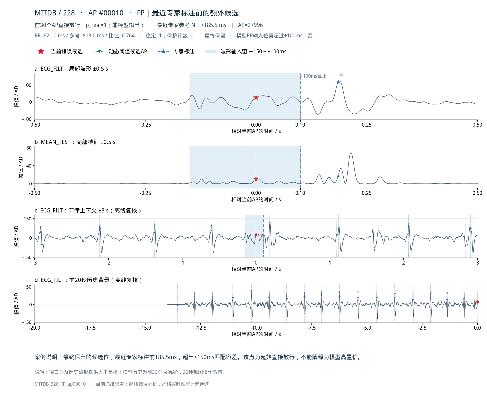
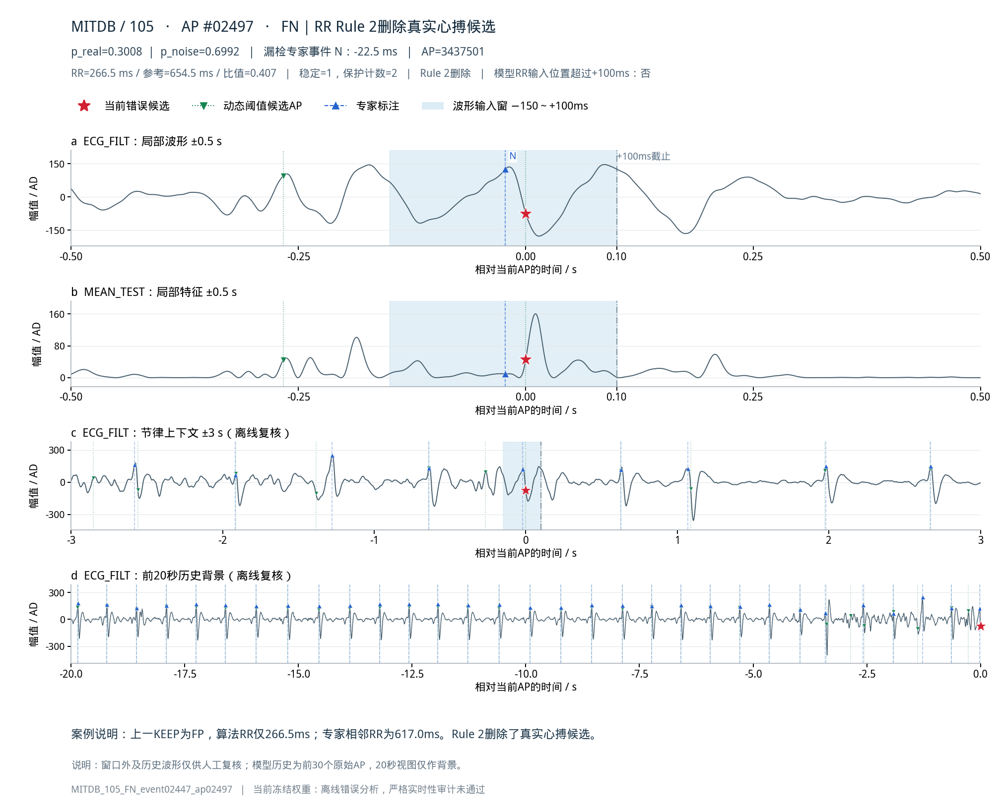

# 报告代表案例

前三张对应：QRS样局部变化FP、窗口内异常心搏FN、重复候选FP。其余为补充。

## QRS样局部突变被高置信放行

案例：`MITDB_105_FP_ap00455`

错误AP附近可见先负后正的快速局部变化，MEAN_TEST也有响应；模型p_real=0.9141。最近专家参考位置在AP后199.5ms，超过评价容差，当前候选仍被保留为FP。图像提示局部形态具有迷惑性，但不能仅凭本图确定噪声的生理来源。

## 窗口内V类真实心搏被模型删除

案例：`MITDB_203_FN_event01942_ap01984`

专家V类心搏位于AP后16ms，已处于波形输入窗内。局部ECG及MEAN_TEST存在多个峰谷，模型p_real=0.2832，关联候选被删除。该例说明异常形态心搏即使参考位置可见，也可能被模型判负。

## 同一专家心搏附近的重复候选

案例：`MITDB_228_FP_ap00329`

专家V类参考位置在当前AP前86.5ms；同一专家事件已由另一候选匹配。当前候选仍以p_real=0.7227保留，形成额外FP。该例属于匹配关系可直接核实的重复候选。

## 专家参考位置超过波形截止的FN

案例：`MITDB_105_FN_event01870_ap01905`

专家N类参考位置位于AP后119.5ms，晚于波形输入的+100ms截止；模型p_real=0.1436，事件最终漏检。这说明参考位置尚未进入当前波形窗，但不能据此断言此前完全没有可辨识线索。

## 保留FP成为RR时间锚点，继而删除真实心搏

案例：`MITDB_105_FN_event01705_ap01717`

当前N类心搏先通过模型，随后被Rule 2删除。上一最终KEEP是FP，算法RR仅201ms，而专家相邻心搏RR为628ms；错误时间锚点使真实心搏看起来明显提前。

## 前30个AP直接放行造成的FP

案例：`MITDB_228_FP_ap00010`

当前候选属于前30个原始AP，未进入模型，p_real=1是测试程序设定的直接放行值。它最终为FP，最近专家位置在AP后185.5ms。该例不能列为模型高置信误判。

## 第二例RR时间锚点污染导致的FN

案例：`MITDB_105_FN_event02447_ap02497`

另一N类心搏同样先通过模型再被Rule 2删除。上一最终KEEP仍是FP，算法RR为266.5ms，而专家相邻RR为617ms；两例共同提示应分析保留FP如何影响后续RR状态。

